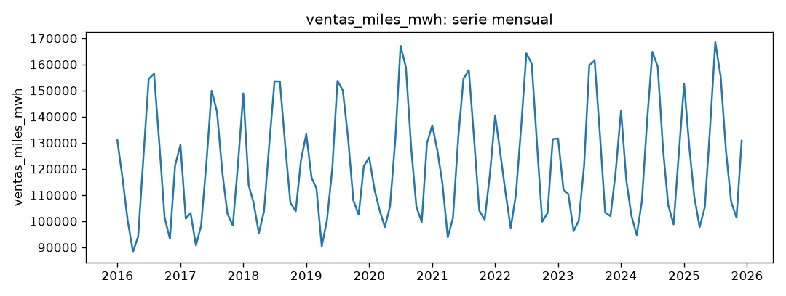
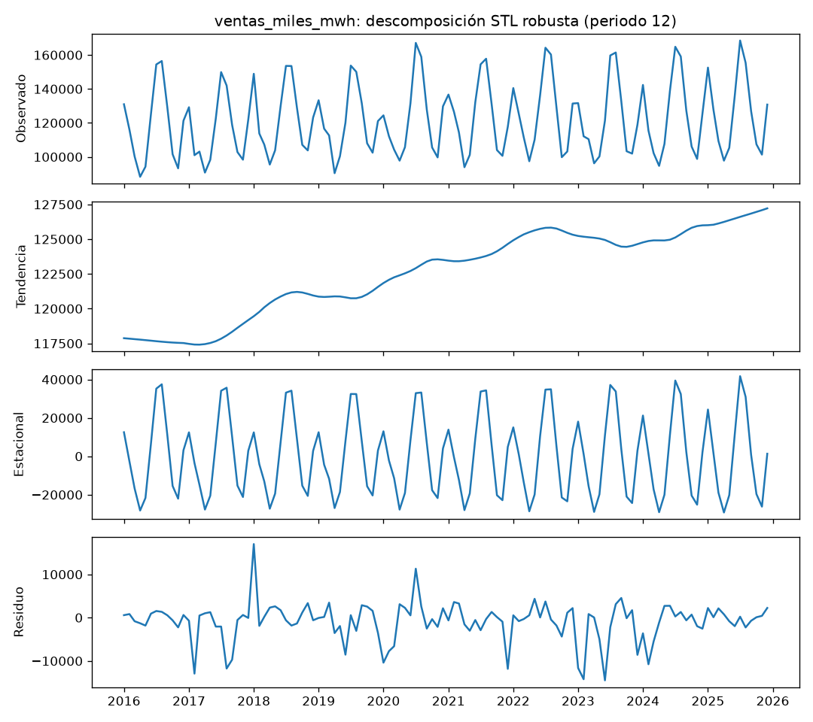
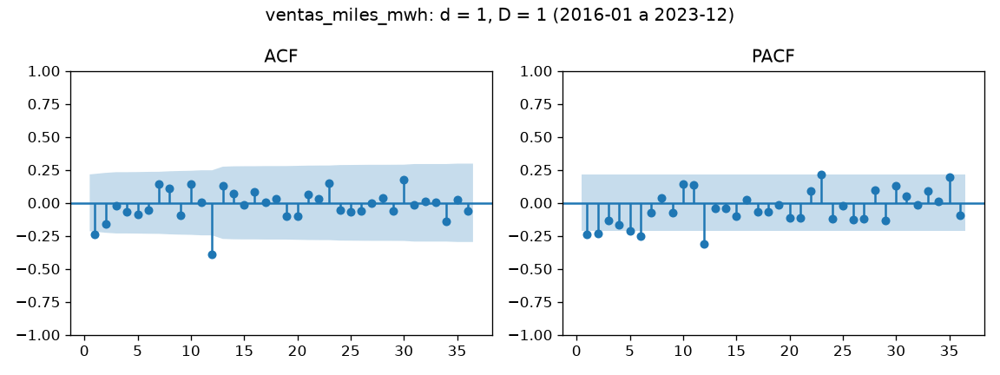
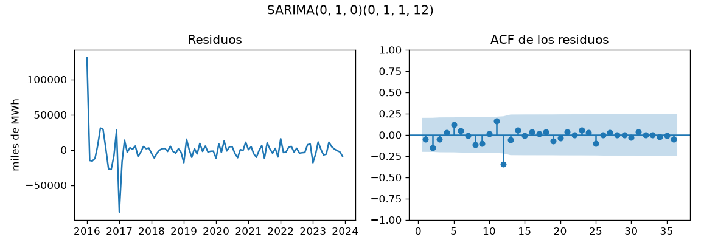

# Informe del miniproyecto 1

Llene cada sección reemplazando los marcadores `{{...}}`, sin quitar las
secciones. Las cifras salen de lo que imprime `python miniproyecto.py` y las
figuras son las que ese guion deja en `figuras/`. Las fórmulas van en LaTeX
(`$...$` o `$$...$$`).

## 1. La serie

La serie mide las ventas mensuales de electricidad a clientes del sector
residencial de Estados Unidos, expresadas en miles de MWh. Cubre de enero
de 2016 a diciembre de 2025, con frecuencia mensual y 120 observaciones,
verificadas consecutivas y sin vacíos. La fuente (la API oficial de la EIA)
y las condiciones de uso están en la ficha
[datos/README.md](../datos/README.md).

Elegí esta serie porque su patrón anual marcado —con picos y valles que se
repiten cada doce meses— permite evaluar si incorporar la estacionalidad
mejora el pronóstico frente a líneas base que la ignoran.

Revisé la serie en busca de huecos y de valores atípicos. No hay huecos:
el archivo verificado contiene los 120 meses consecutivos de enero de 2016
a diciembre de 2025, sin fechas duplicadas ni vacíos, y `preparar()` devuelve
la serie sin cambios.

Para los atípicos, comparé cada observación con los otros 9 valores de su
mismo mes calendario (excluyendo la propia) con dos criterios: la valla de
Tukey, que marca lo que cae fuera de
$[Q_1-1.5\,\mathrm{IQR},\ Q_3+1.5\,\mathrm{IQR}]$ del mes, y el filtro de
Hampel, que marca desviaciones respecto de la mediana del mes mayores que
$3\times 1.4826\times \mathrm{MAD}$. Tukey señaló 8 observaciones (abr-2016,
nov-2016, ago-2017, sep-2017, feb-2021, feb-2022, sep-2023 y feb-2025);
Hampel señaló 4 (nov-2016, ago-2017, sep-2017 y ene-2025). Ambos criterios
coincidieron en noviembre de 2016, agosto de 2017 y septiembre de 2017, que
quedan como los candidatos más firmes; abr-2016 y sep-2023 son marginales,
a menos del 0.5 % de su valla.

Conservé las 120 observaciones originales. Las alertas identifican
observaciones inusuales, no necesariamente errores: ningún valor es
imposible —no hay ceros, negativos ni saltos de registro— y al revisar los
señalados no encontré evidencia de errores de registro. Imputarlas o
recortarlas descartaría información útil para pronosticar. Esta es la
columna `decision` de la tabla.

## 2. Componentes

Apliqué una descomposición STL robusta con un periodo de 12 meses a la serie
preparada. La figura muestra los cuatro paneles del ajuste: la serie
observada, la tendencia, la componente estacional y el residuo.

La tendencia sube de 117873.73 miles de MWh en enero de 2016 a 127217.74 en
diciembre de 2025, un aumento de 9344.01 miles de MWh (el 7.9 %) a lo largo
de la década. No es una recta: se mantiene casi plana entre 2016 y 2019
(117696.65 en junio de 2016 y 119457.09 en enero de 2018), el ascenso se
concentra entre 2020 y 2022 (121843.92 en enero de 2020 y 125742.72 en
junio de 2022) y alrededor de 2023 desciende hasta un mínimo local de
124446.86 en octubre de 2023; desde ahí vuelve a subir hasta los 127217.74
de diciembre de 2025.

Los efectos estacionales se expresan respecto a la tendencia: indican, en
promedio, cuánto agrega o resta cada mes sobre el nivel de tendencia. Julio
es el mes con el efecto más alto (+35449.38 miles de MWh) y agosto le sigue
de cerca (+33927.15): los meses del verano quedan muy por encima de la
tendencia. En el lado opuesto, abril es el más bajo (-28185.58) y noviembre
el segundo más bajo (-22805.84), los meses de ventas más bajas del ciclo
anual. La distancia entre julio y abril, 63634.96 miles de MWh, da la
escala del ciclo.

El residuo recoge lo que ni la tendencia ni la estacionalidad explican. Su
mayor valor en valor absoluto es positivo y ocurre en enero de 2018:
+17009.84 miles de MWh, es decir, ese mes las ventas superaron en esa cantidad
a lo que tendencia y estacionalidad explicaban. Destaca sobre el resto: la
desviación típica del residuo es de 4432.21 miles de MWh y el residuo más
negativo es -14491.71, en junio de 2023. El tamaño del ciclo anual frente a
un residuo de esa escala anticipa la ventaja del estacional ingenuo sobre
el ingenuo que se cuantifica en la sección 3.

## 3. Líneas base y backtest

{{Cómo es el backtest: cuántos orígenes, horizonte y qué meses quedan en la
prueba. Por qué ningún dato posterior al origen entra al modelo.}}

{{RMSE, MAE y MAPE del ingenuo y del estacional ingenuo, y cuál gana.}}

## 4. Estacionariedad e identificación

{{Valor p de la prueba ADF para la serie, su diferencia regular, la
estacional y las dos juntas. El d y el D elegidos.}}

{{Qué rezagos salen de las bandas y qué órdenes sugieren.}}

## 5. Modelos clásicos

{{La rejilla de órdenes y su AIC. El modelo elegido, escrito con su
ecuación.}}

{{Diagnóstico de los residuos: Ljung-Box y lo que muestran la gráfica y su
ACF.}}

{{La variable exógena: qué es, por qué se conoce de antemano y si mejora al
SARIMA.}}

## 6. Tabla de métricas

{{Copie aquí `resultados/metricas.csv` como tabla de Markdown, ordenada por
RMSE.}}

| Modelo | Decisión | RMSE | MAE | MAPE (%) |
|---|---|---|---|---|
| {{...}} | {{...}} | {{...}} | {{...}} | {{...}} |

## 7. Conclusión

{{El mejor modelo clásico, cuánto mejora a la mejor línea base en cada
métrica y en qué meses o tramos sigue fallando. Es el modelo que el
miniproyecto 2 debe superar.}}
